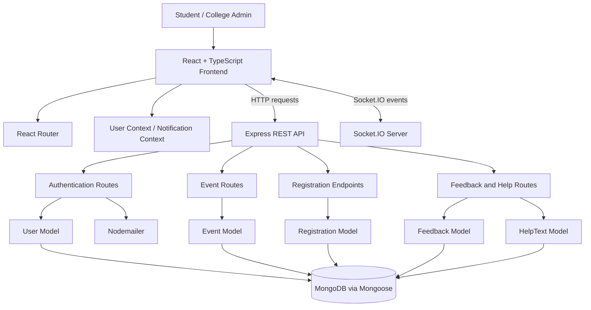
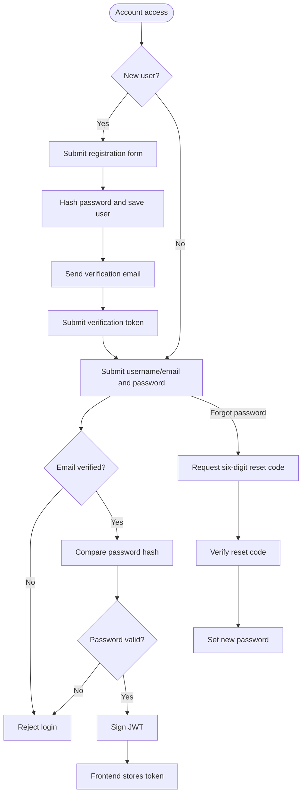
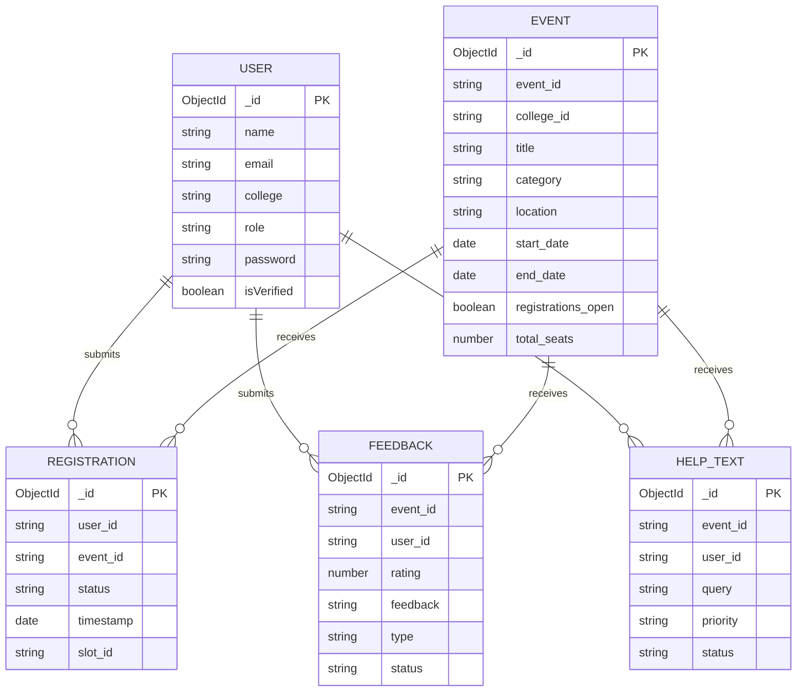

# College Event Hub

A full-stack web application for managing college events, student registrations, event slots, feedback, and help queries. The repository contains a React/TypeScript frontend and an Express/TypeScript backend with MongoDB persistence when configured, plus in-memory mock-data fallbacks for selected features.

[](https://react.dev/)
[](https://www.typescriptlang.org/)
[](https://vite.dev/)
[](https://nodejs.org/)
[](https://expressjs.com/)
[](https://www.mongodb.com/)

> **Repository:** https://github.com/narendra-0821/CollegeEventHub  
> **Project context:** Full Stack Web Development project completed during the Infosys Springboard Internship.

---

## Contents

- [Overview](#overview)
- [Implemented modules](#implemented-modules)
- [Technology stack](#technology-stack)
- [Architecture](#architecture)
- [Authentication flow](#authentication-flow)
- [Data models](#data-models)
- [API reference](#api-reference)
- [Repository structure](#repository-structure)
- [Getting started](#getting-started)
- [Environment configuration](#environment-configuration)
- [Run the application](#run-the-application)
- [Assets and screenshots](#assets-and-screenshots)
- [Testing status](#testing-status)
- [Project documents](#project-documents)
- [Security and implementation notes](#security-and-implementation-notes)
- [Potential improvements](#potential-improvements)
- [Internship context](#internship-context)

## Overview

College Event Hub provides a shared interface for students and college administrators to work with college events. The source code includes separate student and administrator pages, event creation and editing components, event registration workflows, feedback/help handling, and notification-related functionality.

The backend exposes REST endpoints through Express. Mongoose models are used when MongoDB is connected. The database service explicitly falls back to in-memory mock data when `MONGODB_URI` is not configured or the database is not ready. Data written in that fallback mode is not durable across process restarts.

### Project context from the supplied documentation

The project report describes College Event Hub as a centralized platform for inter-college activities, including hackathons, sports competitions, cultural programmes, workshops, and seminars. Its stated purpose is to bring event discovery, scheduling, promotion, student registration, administrator approvals, feedback, and event-related communication into one place. The report emphasizes reducing manual registration effort, improving visibility of events across colleges, and helping organizers learn from participant feedback.

The project presentation describes three user roles: **students, college admins, and super admins**. It highlights role-specific dashboards, event creation and registration, registration/slot management, community feedback, and feedback analysis. The source code contains role-aware frontend and backend logic, but the security observations below explain why role labels in the interface should not be treated as proof of complete server-side RBAC enforcement.

The report and presentation describe intended outcomes such as more efficient event administration, easier student participation, timely updates, and continuous improvement through feedback. These are project objectives and qualitative claims in the supplied materials; no measured performance or impact metrics were provided in the materials inspected.

## Implemented modules

The following modules are represented in the repository source code. Their presence in source does not by itself constitute end-to-end test evidence.

### Student-facing functionality

- Account registration with name, email, college, role, password, and confirmation fields.
- Email verification before login.
- Login using username or email and password.
- Forgot-password flow using a six-digit email code.
- Event discovery with search and category, date, and status filters.
- Event detail views.
- Registration confirmation flow, including optional event-slot selection.
- Student dashboard and registered-event views.
- Event feedback and help-query submission paths.

### Administrator-facing functionality

- Administrator dashboard.
- Event creation, editing, and deletion.
- Event registration listing and registration-status updates.
- Registration opening/closing and capacity-related handling.
- Event slots and per-slot approved-registration counts.
- Feedback and help-query review interfaces and API functionality.

### Real-time and email functionality

- Socket.IO server and client integration for events such as new registrations, feedback, registration-count updates, and registration-status changes.
- Nodemailer email service for verification and password-reset messages. An Ethereal test account is used as the development fallback when SMTP settings are not configured.

## Documented modules and objectives

The supplied project report (pages 1 and 4–7) and presentation (slides 3–7) describe the following functional scope. The implementation column is based on the repository source review; a documented requirement is not automatically evidence of a fully working end-to-end feature.

| Documented capability | Description in project materials | Source-code observation |
|---|---|---|
| Authentication and role-specific access | Student/admin registration and login, role-specific dashboards | Registration, login, email verification, password reset and role-aware pages are present. Complete authorization enforcement remains a security gap. |
| Event discovery | Browse events and filter by category, date or hosting college | Event listing and filtering UI/API code is present; exact filter behavior depends on the selected API mode. |
| Event creation and administration | Admin creates, edits and deletes event listings | Event create/update/delete handlers and admin UI are present. |
| Registration and slot management | Students register; admins review and approve/reject participants; event slots and capacity are managed | Registration endpoints, status updates and slot-related code are present. |
| Feedback and analysis | Students submit ratings/comments; admins review feedback | Feedback model, event feedback handlers and admin/student UI are present. |
| Notifications | Updates about event changes and registration status | Socket.IO event plumbing is present; persistent notification storage is not implemented in the inspected code. |
| Profile management and activity logs | Student profile access and admin activity tracking | The user profile endpoint includes mock data; a complete persistent profile/activity-log implementation was not verified. |
| Responsive experience | Desktop, tablet and mobile layouts | Responsive styling is used in the frontend; no device-by-device test report was supplied. |

### Problem context and objectives

The report frames the problem as event information and administration being spread across separate processes, making it harder for students to discover inter-college opportunities and for organizers to coordinate schedules, registrations, approvals and feedback. The stated objectives are to centralize event listings, simplify online registration, reduce administrative effort, encourage participation through updates, collect feedback, and promote interaction among students from different colleges. (Project Documentation, page 1.)

### Future enhancements stated in the project report

The report's page 17 lists these as **future enhancements**, not current implemented features:

- Integrations with Slack or Microsoft Teams and Google Calendar synchronization.
- AI-based event recommendations using interests, attendance and feedback history.
- Advanced analytics for registration/attendance trends, participant demographics and feedback summaries.
- Android and iOS applications with push notifications.
- QR-code attendance/check-in.
- Payment gateway integration for paid events.

## Technology stack

| Area | Technologies evidenced by package manifests and source |
|---|---|
| Frontend | React 19, TypeScript, Vite 6 |
| Styling | Tailwind CSS 4, Tailwind Vite plugin |
| UI primitives | Radix UI components, custom UI components |
| Routing | React Router DOM 7 |
| Icons | Lucide React |
| State | React Context; Zustand is listed as a dependency |
| HTTP | Fetch API in inspected page code; Axios is also listed as a dependency |
| Backend | Node.js, Express 4, TypeScript, `tsx` development runner |
| Database | MongoDB, Mongoose 8 |
| Authentication | JSON Web Tokens (`jsonwebtoken`), `bcryptjs` |
| Email | Nodemailer |
| Real-time | Socket.IO 4 (server and client) |
| Other backend packages | `cors`, `dotenv`, `uuid`, `express-rate-limit`, `joi` |

## Architecture

The diagram summarizes the main components observed in the repository. It is a component-level view, not a deployment diagram.



### Request and persistence behavior

1. The frontend sends HTTP requests to the Express API. During Vite development, `/api` is proxied to `http://localhost:4000` by default.
2. Express dispatches requests to authentication, event, user, registration, feedback, and help-query handlers.
3. The database service attempts to connect to MongoDB using `MONGODB_URI`.
4. Routes with explicit fallback logic use in-memory mock data when the database is not ready.
5. Socket.IO emits selected event and registration updates to connected clients.
6. Nodemailer sends verification and password-reset emails, using configured SMTP or an Ethereal test account.

## Authentication flow



The user model hashes modified passwords using `bcryptjs` with a generated salt. Authentication code issues JWTs with an expiry setting. The current source also contains security and authorization caveats described in [Security and implementation notes](#security-and-implementation-notes).

## Data models

The backend defines five Mongoose models.

| Model | Responsibility | Selected fields |
|---|---|---|
| `User` | User account and authentication data | `name`, `email`, `college`, `role`, password hash, verification and reset-token fields |
| `Event` | College event details and scheduling | `event_id`, `college_id`, `title`, `category`, `location`, dates, registration flag, total seats, slots |
| `Registration` | Student registration against an event | `user_id`, `event_id`, `status`, timestamp, denormalized user/event details, `slot_id` |
| `Feedback` | Feedback and ratings | event/user IDs, name/email, rating, feedback, type, status, admin response |
| `HelpText` | Student questions and support queries | event/user IDs, query, category, priority, status, response, helpful count, tags |

The IDs connecting users, events, and dependent records are represented as string fields in these schemas; the schemas do not define Mongoose `ref` relationships for these fields.



## API reference

Base URL for local development: `http://localhost:4000`.

### Health and root

| Method | Endpoint | Purpose |
|---|---|---|
| GET | `/` | API information and endpoint hints |
| GET | `/api/health` | Health response with timestamp |

### Authentication (`/api/auth`)

| Method | Endpoint | Purpose |
|---|---|---|
| POST | `/register` | Create account and send email verification |
| POST | `/login` | Authenticate with username/email and password |
| GET | `/me` | Return the current user from a Bearer JWT |
| POST | `/verify` | Verify email using email and token |
| POST | `/forgot-password` | Request a six-digit reset code |
| POST | `/verify-reset-code` | Validate reset code |
| POST | `/reset-password` | Change password using verified reset code |

### Events (`/api/event`)

| Method | Endpoint | Purpose |
|---|---|---|
| GET | `/` | List events; supports category, college, limit, and offset query parameters |
| GET | `/:id` | Retrieve an event by Mongo ID or human event ID in database mode |
| POST | `/` | Create an event |
| POST | `/:id/register` | Legacy/in-memory event registration handler |
| PUT | `/:id` | Update an event |
| GET | `/:id/registrations` | List registrations for an event; optional `slot` filter |
| GET | `/:id/slots` | Return configured slots and, when available, approved counts |
| PUT | `/:id/registration-status` | Open or close event registration |
| DELETE | `/:id` | Delete event and related registrations in database mode |
| POST | `/:eventId/feedback` | Submit an event rating or help query depending on payload |
| GET | `/:id/feedbacks` | List event help queries |
| GET | `/:id/feedbacks/unread-count` | Count unread help queries |
| PUT | `/:id/feedbacks/mark-read` | Mark event help queries read |
| GET | `/:id/event-feedbacks` | List after-event feedback |
| GET | `/:id/event-feedbacks/unread-count` | Count unread after-event feedback |
| PUT | `/:id/event-feedbacks/mark-read` | Mark after-event feedback read |

### Registrations (registered directly in `server.ts`)

| Method | Endpoint | Purpose |
|---|---|---|
| POST | `/api/registration` | Create a registration; database path checks duplicates and event capacity |
| GET | `/api/registrations/user/:userId` | List registrations for a user |
| PUT | `/api/registration/:id/status` | Update registration status (`pending`, `approved`, or `rejected`) |

### Other route modules

The repository also contains `backend/src/routes/feedback.ts`, `backend/src/routes/help.ts`, and `backend/src/routes/users.ts`. The current `server.ts` mounts `/api/event`, `/api/user`, and `/api/auth`; it does not mount the standalone feedback and help routers. The user router exposes `/api/user/profile`, `/api/user/:id/registrations`, and nests auth routes at `/api/user/auth` in addition to the separately mounted `/api/auth` routes.

> **Authorization note:** The API table documents registered route handlers, not a claim that every endpoint enforces authentication or role authorization. Review route protection before deploying this application publicly.

## Repository structure

```text
CollegeEventHub/
├── backend/
│   ├── src/
│   │   ├── data/mockData.ts
│   │   ├── middleware/
│   │   │   ├── rateLimiter.ts
│   │   │   └── validation.ts
│   │   ├── models/
│   │   │   ├── Event.ts
│   │   │   ├── Feedback.ts
│   │   │   ├── HelpText.ts
│   │   │   ├── Registration.ts
│   │   │   └── User.ts
│   │   ├── routes/
│   │   │   ├── auth.ts
│   │   │   ├── events.ts
│   │   │   ├── feedback.ts
│   │   │   ├── help.ts
│   │   │   └── users.ts
│   │   ├── services/
│   │   │   ├── db.ts
│   │   │   ├── emailService.ts
│   │   │   └── jwt.ts
│   │   └── server.ts
│   ├── package.json
│   ├── package-lock.json
│   ├── tsconfig.json
│   ├── DEVELOPMENT.md
│   └── LICENSE
├── frontend/
│   ├── public/
│   ├── src/
│   │   ├── components/
│   │   ├── contexts/
│   │   ├── hooks/
│   │   ├── lib/
│   │   └── pages/
│   ├── App.tsx
│   ├── main.tsx
│   ├── package.json
│   ├── package-lock.json
│   ├── tsconfig.json
│   └── vite.config.ts
├── College Event Hub Documentation.pdf
├── College Event Hub _ Presenation.pptx
├── College Event Hub _ Test Cases Status.pdf
└── Full stack College Event Hub_Problem Statement.pdf
```

The repository also contains a root-level `frontend/App.tsx` alongside `frontend/src/App.tsx`; the Vite entry point and import structure should be checked if restructuring the frontend.

## Getting started

### Prerequisites

- Node.js and npm (use a supported current LTS release).
- MongoDB database/connection string for persistent storage. Without a ready MongoDB connection, selected routes use in-memory mock data.

### 1. Configure and start the backend

```bash
cd backend
npm install
npm run dev
```

The backend development script runs `tsx watch src/server.ts`. The server listens on `http://localhost:4000` by default, or on the configured `PORT`.

### 2. Configure and start the frontend

In a second terminal:

```bash
cd frontend
npm install
npm run dev
```

Vite serves the frontend at `http://localhost:5173` by default. The Vite config proxies `/api` requests to `http://localhost:4000` unless `VITE_BACKEND_URL` overrides the target.

### 3. Production build scripts

Backend:

```bash
cd backend
npm run build
npm start
```

Frontend:

```bash
cd frontend
npm run build
npm run preview
```

These commands reflect the scripts declared in the respective `package.json` files. The build and runtime commands have not been executed as part of this repository inspection.

## Environment configuration

Create a local `backend/.env` file. Do not commit it. The backend source references these environment variables:

| Variable | Purpose |
|---|---|
| `MONGODB_URI` | MongoDB connection string |
| `PORT` | Backend listening port; default is `4000` |
| `NODE_ENV` | Runtime environment setting |
| `JWT_SECRET` | Secret used to sign and verify JWTs |
| `JWT_EXPIRES_IN` | JWT expiry; source default is `7d` |
| `FRONTEND_URL` | Frontend base URL used in email verification links |
| `EMAIL_HOST` | SMTP host |
| `EMAIL_PORT` | SMTP port; email service fallback default is `587` |
| `EMAIL_SECURE` | Whether SMTP uses secure transport |
| `EMAIL_USER` | SMTP username |
| `EMAIL_PASS` | SMTP password |
| `EMAIL_FROM` | Sender address |

Example template (replace all placeholders locally):

```dotenv
PORT=4000
NODE_ENV=development
MONGODB_URI=mongodb://127.0.0.1:27017/college_event_hub
JWT_SECRET=replace_with_a_long_random_secret
JWT_EXPIRES_IN=7d
FRONTEND_URL=http://localhost:5173
EMAIL_HOST=smtp.example.com
EMAIL_PORT=587
EMAIL_SECURE=false
EMAIL_USER=your_smtp_username
EMAIL_PASS=your_smtp_password
EMAIL_FROM=no-reply@example.com
```

The frontend contains `frontend/.env.development` with `VITE_BACKEND_URL=http://localhost:4000`. Vite exposes variables prefixed with `VITE_` to client-side code; never put secrets in frontend environment variables.

## Assets and screenshots

Image assets found in `frontend/public/` include:

| Path | Referenced use or observed filename |
|---|---|
| `frontend/public/background.webp` | Login and registration background in page components |
| `frontend/public/logo.png` | Campus Event Hub branding in login/registration pages |
| `frontend/public/clg.png` | College image in login page |
| `frontend/public/relaxed.png` | Image asset; precise in-app use not confirmed in inspected source |
| `frontend/public/sad.png` | Image asset; precise in-app use not confirmed in inspected source |
| `frontend/public/placeholder.jpg` | Placeholder image |
| `frontend/public/placeholder-user.jpg` | Placeholder user image |
| `frontend/public/placeholder-logo.png` / `.svg` | Placeholder logo assets |
| `frontend/public/placeholder.svg` | Placeholder SVG asset |

The repository does not currently contain a dedicated, clearly named application-screenshot directory. The assets above should not all be treated as screenshots of running application screens.

To add verified screenshots later, place them in a documented directory such as `docs/images/` and reference them with relative Markdown paths, for example:

```markdown

```

## Project presentation and UI walkthrough

The supplied presentation is titled **“Project Presentation on Campus Event Hub”** and describes the system as an efficient platform for managing and participating in campus events. It labels the technology approach as MERN (MongoDB, Express.js, React.js and Node.js). The current source tree additionally uses TypeScript, Vite, Tailwind CSS, Mongoose, Socket.IO and supporting libraries.

The presentation includes a sequence of UI walkthrough slides (slides 8–15):

| Slide | Screen shown | What the slide demonstrates |
|---:|---|---|
| 8 | Login page | Campus Event Hub sign-in screen |
| 9 | Student dashboard | Student landing page with event and registration summary cards |
| 10 | Admin dashboard | Event/registration summary and event-management controls |
| 11 | Event creation by admin | Event form with title, description, category, location, capacity and date/time fields |
| 12 | Event registration | Student-facing registration success state |
| 13 | Manage registration | Admin view for participant status/approval management |
| 14 | Student feedback submission | Star rating and written feedback form |
| 15 | Admin feedback analysis | Admin feedback overview with ratings and comments |

These are presentation screenshots, not separately stored application screenshot files in the repository. To display them as individual images in GitHub README, export the slides and commit the resulting image files under a path such as `docs/images/`; no such screenshot path is claimed here.

The presentation also identifies the team as: Vishal Kodiganti, Vaishnavi Gholap, Gurrala Bhagyasree, Sai Thoran, and Sankari (slide 16).

[Open the project presentation](College%20Event%20Hub%20_%20Presenation.pptx)

## Testing status

A test-status PDF is present in the repository, but it was not among the files supplied for detailed extraction in this review. Therefore, this README does **not** assert test IDs, executed inputs, actual outputs, pass/fail counts, or a test pass percentage.

- [College Event Hub – Test Cases Status PDF](College%20Event%20Hub%20_%20Test%20Cases%20Status.pdf)
- No dedicated automated test script was present in either inspected `package.json` manifest.
- The code review is not a substitute for executing functional, integration, security, or acceptance tests.

Populate a test-results table only after transcribing and verifying the source test report:

| Test ID | Module | Test scenario | Expected result | Actual result | Status |
|---|---|---|---|---|---|
| Pending document extraction | — | See linked test-status PDF | — | Not independently verified here | Pending |

## Project documents

The following source documents are kept in the repository:

- [Project Documentation (PDF)](College%20Event%20Hub%20Documentation.pdf) — reviewed (17 pages). Covers project description and purpose, setup guidance, folder structure, feature/module descriptions, illustrative API examples, troubleshooting, glossary/FAQ and future enhancements.
- [Project Presentation (PPTX)](College%20Event%20Hub%20_%20Presenation.pptx) — reviewed (18 slides). Covers the MERN stack, feature scope, outcomes, challenges and mitigations, role-specific UX, UI walkthrough screenshots, and team members.
- [Test Cases Status (PDF)](College%20Event%20Hub%20_%20Test%20Cases%20Status.pdf) — present in the GitHub repository, but its contents have not yet been supplied for detailed extraction in this review.
- [Original Problem Statement (PDF)](Full%20stack%20College%20Event%20Hub_Problem%20Statement.pdf) — present in the GitHub repository, but its contents have not yet been supplied for detailed extraction in this review.

### Documentation-to-code discrepancies

- The report's setup examples mention `npm start` for the frontend, whereas the current frontend package manifest uses Vite scripts (`npm run dev`, `npm run build`, and `npm run preview`). Follow the repository package scripts documented in [Getting started](#getting-started).
- The report includes older/alternate API examples such as `/api/user/auth/register`, `/api/user/auth/me`, and `/api/user/:id/registrations`, plus example ports 3000 and 1000. The currently mounted implementation exposes authentication under `/api/auth` and runs on port 4000 by default; consult the source-derived API table above.
- The report's sample environment configuration refers to `USER_DB_URL`, `JOB_DB_URL`, `NOTIFICATION_DB_URL`, and `APPLICATION_DB_URL`. The inspected backend service uses `MONGODB_URI`; do not copy the older sample variable names into the current setup.
- The report's folder-structure text contains the unrelated project name “Right Resource Fit” in places, indicating reused template text.
- The presentation calls the project “Campus Event Hub” while the repository/report use “College Event Hub”. This README uses the repository name.
- The presentation discusses three roles, including `super_admin`; the source code has role-aware UI and role values, but route/socket authorization should be strengthened before claiming complete RBAC.

## Security and implementation notes

The following are source-code observations and should be addressed before a production deployment:

1. **Tracked backend environment file:** `backend/.env` is present in the Git tree. Remove it from version control, add appropriate `.env` patterns to `.gitignore`, and rotate any credentials or secrets that may have been committed. Removing a file from the latest commit does not remove its previous Git history.
2. **JWT fallback secret:** `backend/src/services/jwt.ts` contains a hardcoded fallback value for `JWT_SECRET`. Production startup should fail safely when a strong secret is not configured.
3. **Authentication and authorization coverage:** Several event and registration handlers do not show authentication/role middleware in the inspected route definitions. Enforce authentication and server-side role/ownership checks for administrative writes and private data.
4. **Socket.IO role trust:** The server joins a room based on the role supplied by the connecting client. Authenticate the socket and derive the role from a verified server-side identity before joining privileged rooms.
5. **Registration hook token:** `frontend/src/hooks/useRegistration.ts` sends a literal `mock-token` in Authorization headers. Use the real session token and enforce it on the server.
6. **Mock profile and notifications:** `backend/src/routes/users.ts` returns a mock profile, and `/api/notifications` in `server.ts` constructs mock notifications rather than reading a persistent notification store.
7. **Mock-data fallback:** When MongoDB is not ready, selected routes mutate in-memory arrays. This is suitable only as a development/demo fallback; it is not durable storage.
8. **Validation/rate limiter wiring:** Validation and rate-limiter utilities exist, but the inspected server mounting does not demonstrate consistent application across all relevant routes. Confirm and test route-level use.
9. **Email development fallback:** When real SMTP credentials are absent, Nodemailer creates an Ethereal test account. This is a development/test behavior, not a production delivery configuration.

No secret values are included in this README.

## Potential improvements

- Add complete authentication, authorization, and ownership enforcement for all protected operations.
- Remove hardcoded tokens and fallback credentials; validate required environment variables at startup.
- Persist notifications and implement read/unread state instead of generating mock notifications.
- Add automated unit, API integration, and frontend component tests; publish the exact test command and verified results.
- Add structured logging and a consistent API error-response format.
- Document real deployment settings, CORS origins, SMTP configuration, and database setup.
- Add dedicated application screenshots and an optional demo video to `docs/`.
- Consolidate stale instructions in `backend/DEVELOPMENT.md` (it mentions an `auth-system` directory/Next.js app not present in the inspected repository tree).
- Review duplicate or legacy route paths and align frontend API calls with the mounted backend routes.

## Internship context

This project was completed during the Infosys Springboard Internship as a Full Stack Web Development project. The supplied presentation lists the project team as Vishal Kodiganti, Vaishnavi Gholap, Gurrala Bhagyasree, Sai Thoran, and Sankari. The repository is associated with the project; individual contribution ownership is not specified in the inspected materials.

---

## Notes for contributors

- Keep credentials in local environment files and out of version control.
- Update this README when API paths, configuration keys, or major modules change.
- Report test outcomes only when the corresponding tests have actually been run and their results recorded.
